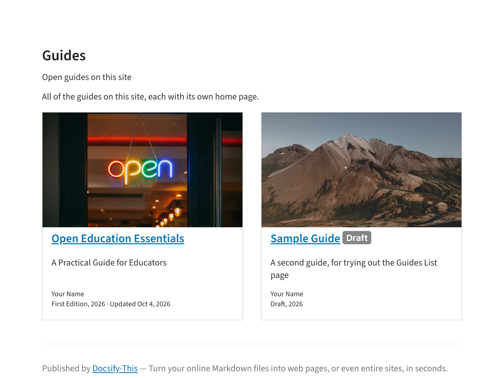

# Docsify-This Multiple Guides Site Template

> This is a multiple guides site template for use with [Docsify-This.net](https://docsify-this.net/#/). Its two example guides, **Open Education Essentials** and a **Sample Guide**, come from [Grav Open Publishing Space](https://github.com/hibbitts-design/grav-skeleton-open-publishing-space), published from the same Markdown files.

_Figure 1. Docsify-This Multiple Guides Site Template. Explore the resulting standalone web site generated by Docsify-This.net at [https://docsify-this.net/?basePath=https://raw.githubusercontent.com/hibbitts-design/docsify-this-multiple-guides-site/main&homepage=home.md&sidebar=true&loadSidebar=_sidebar.md&loadNavbar=_navbar.md&collapsibleSidebarGroups=true&pagination=true&searchbox=true&name=Open%20Publishing%20Space%20Guides](https://docsify-this.net/?basePath=https://raw.githubusercontent.com/hibbitts-design/docsify-this-multiple-guides-site/main&homepage=home.md&sidebar=true&loadSidebar=_sidebar.md&loadNavbar=_navbar.md&collapsibleSidebarGroups=true&pagination=true&searchbox=true&name=Open%20Publishing%20Space%20Guides)_

How to Use
---

1. Sign in to [GitHub](https://github.com), or create an account if you don’t already have one.

2. Tap **Use this template** in this repository (upper-right green button) and then choose **Create a new repository**

3. Choose the name for your new repository to contain the files and then tap **Create repository from template**

4. View an included Markdown file, for example **home.md**, and copy its URL.

5. Go to https://docsify-this.net and paste the copied URL into the **Markdown File URL** field

6. Select the page options you want (e.g. Docsify Sidebar) and tap the **Publish as a Web Page** button to view your Markdown file as a web page for sharing or embedding

> [!NOTE]
> For this template to work as designed, choose **Sidebar** for page layout and, in the **Advanced Web Page Builder Options** section, load the Docsify custom **Sidebar** and **Navbar** files. Each guide folder has its own `_sidebar.md` and `_navbar.md`, which load as you move between guides.

To edit a file in GitHub, tap the **Pencil icon** (Edit this file) in the upper-right when viewing the file, make your changes, and then tap the **Commit changes...** button to save those changes.  

To load the provided [Docsify custom sidebars](https://docsify.js.org/#/more-pages?id=sidebar) and [Docsify custom navbars](https://docsify.js.org/#/custom-navbar?id=custom-navbar), with collapsible sidebar groups, manually add `&loadSidebar=_sidebar.md&loadNavbar=_navbar.md&collapsibleSidebarGroups=true` to your published Docsify-This URL, for example:
https://docsify-this.net/?basePath=https://raw.githubusercontent.com/hibbitts-design/docsify-this-multiple-guides-site/main&homepage=home.md&sidebar=true&loadSidebar=_sidebar.md&loadNavbar=_navbar.md&collapsibleSidebarGroups=true

Using the ability to change the default values of the Docsify-This Web Page Builder, here are the needed **Sidebar**, **Navbar**, **collapsible Sidebar groups**, **Previous/Next page buttons** and **Search** options already set - just replace the default Markdown file URL for **home.md** with your own! https://docsify-this.net/?advanced=true&url-field=https://github.com/hibbitts-design/docsify-this-multiple-guides-site/blob/main/home.md&sidebar=true&loadSidebar=true&loadNavbar=true&collapsibleSidebarGroups=true&pagination=true&searchbox=true&name=Open%20Publishing%20Space%20Guides

> [!IMPORTANT]
> To add an edit link, set `edit-link` to your repository (for example `&edit-link=https://github.com/your-name/your-repo`), not to a Markdown file – with a Markdown file, links between the guides stop working.

Add a Guide
---

- `home.md` – the Guides page, with a card for each guide
- `open-education-essentials/`, `sample-guide/` – one folder per guide: `README.md` (its home page), a folder per section with its pages, `_sidebar.md` (the reading order, with collapsible section groups) and `_navbar.md`

Each guide follows the same pattern – keep it when you add one:

- `_sidebar.md` lists only the guide's reading order: its sections and their pages, not the guide home
- Every reading page starts with a link back to its guide home, such as `[← Sample Guide](sample-guide/README.md)`
- The Guides page and each guide home hide the sidebar, with the `<style>` line (and the comment above it) at the end of the file – copy it to any other page that isn't part of a reading order
- `_navbar.md` holds the links to the rest of the site, such as All Guides

To add a guide:

1. Copy a guide folder, such as `sample-guide/`, and give it a new name
2. In all of its Markdown files, change `sample-guide/` in the links to the new folder name (links start from the site's top folder)
3. Edit its `README.md` (the guide home page and its section cards), its pages, and its `_sidebar.md` (the reading order)
4. Add a card for it to `home.md`, linking to its `README.md` – with three or more guides, change `card-list` to `card-list-guides` there for three cards in a row

> [!TIP]
> Images go in the same folder as the page that shows them.

Docsify-This Examples
---

Multiple Guides Site [home.md](https://github.com/hibbitts-design/docsify-this-multiple-guides-site/blob/main/home.md) file displayed by Docsify-This as: 
* [Standalone Site with a Docsify Sidebar and Navbar for each guide](https://docsify-this.net/?basePath=https://raw.githubusercontent.com/hibbitts-design/docsify-this-multiple-guides-site/main&homepage=home.md&sidebar=true&loadSidebar=_sidebar.md&loadNavbar=_navbar.md&collapsibleSidebarGroups=true "Docsify-This Multiple Guides Site - Standalone Site with a Docsify Sidebar and Navbar for each guide")  
* [Standalone Site with a Docsify Sidebar and Navbar for each guide, Pagination buttons and Search](https://docsify-this.net/?basePath=https://raw.githubusercontent.com/hibbitts-design/docsify-this-multiple-guides-site/main&homepage=home.md&sidebar=true&loadSidebar=_sidebar.md&loadNavbar=_navbar.md&collapsibleSidebarGroups=true&pagination=true&searchbox=true "Docsify-This Multiple Guides Site - Standalone Site with Pagination buttons and Search")  
* [Standalone Site with a Docsify Sidebar and Navbar for each guide, Pagination buttons, Search, Website name and a 'Source Markdown Files' link](https://docsify-this.net/?basePath=https://raw.githubusercontent.com/hibbitts-design/docsify-this-multiple-guides-site/main&homepage=home.md&sidebar=true&loadSidebar=_sidebar.md&loadNavbar=_navbar.md&collapsibleSidebarGroups=true&pagination=true&searchbox=true&name=Open%20Publishing%20Space%20Guides&edit-link=https://github.com/hibbitts-design/docsify-this-multiple-guides-site&edit-link-text=Source%20Markdown%20Files&edit-link-emoji=:file_folder: "Docsify-This Multiple Guides Site - Standalone Site with Pagination buttons, Search, Website name and a 'Source Markdown Files' link")

The guides' content is licensed [CC BY 4.0](https://creativecommons.org/licenses/by/4.0/) – copy it, adapt it and share it, with credit.
